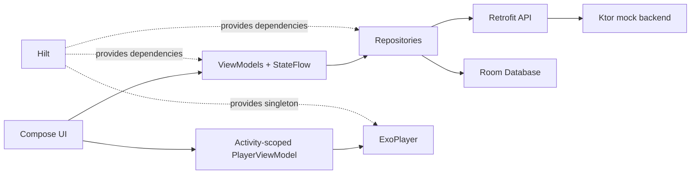

# Favify

Favify is a Kotlin Android favorites app inspired by Spotify. It combines a Jetpack Compose client with a lightweight Kotlin Ktor mock backend and supports feed browsing, album details, persistent favorites, and global music playback.


## Features

- **Home feed:** browse album sections delivered by the Ktor `/feed` endpoint.
- **Album playlists:** open album details and load songs from `/playlist/{id}`.
- **Persistent favorites:** save and remove favorite albums with Room Database.
- **Global playback:** play and pause tracks from any screen with ExoPlayer, including seek controls and playback progress.
- **Navigation:** switch between Home and Favorite with Jetpack Navigation and Material Bottom Navigation.
- **Responsive state:** Kotlin Coroutines and StateFlow keep network and database work off the main thread.

| Playlist | Global player | Favorites |
| --- | --- | --- |
|  |  |  |

## Architecture



## Repository layout

```text
android/                 Android application
  app/src/main/java/     Activities, Compose screens, ViewModels, repositories, Room, and player
  app/src/main/res/      Navigation graph, layouts, icons, themes, and resources
backend/                 Kotlin Ktor mock REST API
  src/main/kotlin/       Routes and server configuration
  src/main/resources/    Feed and playlist fixtures
docs/screenshots/        Verified emulator screenshots
```

## Tech stack

- Kotlin, Android Jetpack, Jetpack Compose, Material Components
- MVVM, Hilt dependency injection, Kotlin Coroutines, StateFlow
- Jetpack Navigation, Retrofit, Gson, Coil
- Room Database
- Google ExoPlayer
- Kotlin Ktor and Netty

## Run locally

### Prerequisites

- Android Studio with Android SDK 33 or newer
- Android emulator or device running API 23 or newer
- JDK 11 for the Ktor backend

### 1. Start the backend

```bash
cd backend
./gradlew run
```

The service listens on `http://localhost:8080`. The Android emulator reaches it through `http://10.0.2.2:8080`.

The public repository does not redistribute the course demo MP3 tracks. Add legally distributable MP3 files under `backend/src/main/resources/static/songs/` and keep their filenames aligned with `playlists.json` to exercise audio playback.

### 2. Run the Android app

Open `android/` in Android Studio, allow Gradle sync to finish, select an emulator, and run the `app` configuration. From a terminal you can also build and test it with:

```bash
cd android
./gradlew assembleDebug
./gradlew testDebugUnitTest
```

## API endpoints

| Method | Endpoint | Purpose |
| --- | --- | --- |
| `GET` | `/` | Health response |
| `GET` | `/feed` | Home feed sections |
| `GET` | `/playlists` | Playlist fixtures |
| `GET` | `/playlist/{id}` | One album playlist |
| `GET` | `/songs/{filename}` | Local audio asset |

## Validation

The project was verified with Android debug assembly, Android unit tests, a clean Ktor build, endpoint health checks, and an emulator walkthrough covering Home, Playlist, Favorite persistence, global playback, and seek behavior.

## Implementation notes

- Hilt supplies Retrofit, Room, repositories, ViewModels, and the singleton ExoPlayer instance.
- Network and Room operations run through coroutines on `Dispatchers.IO`; ViewModels expose UI state with StateFlow.
- Favorites are user-controlled and persist across app restarts. No startup seed data is inserted.
- This is an educational mock service, not a production Spotify integration, and no Spotify credentials or private API keys are included.
